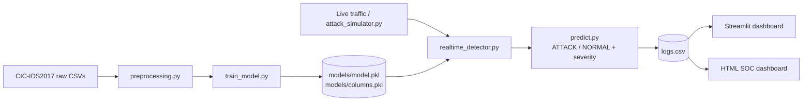

<div align="center">

# 🛡️ Edge AI-Based Cybersecurity Agent

**Real-time network attack detection with a machine learning model and live SOC-style dashboards.**


[Overview](#-overview) •
[Features](#-features) •
[Architecture](#-architecture) •
[Quick Start](#-quick-start) •
[Dashboards](#-dashboards) •
[Dataset](#-dataset) •
[Roadmap](#-roadmap)

</div>

---

## 📌 Overview

Traditional intrusion detection often depends on cloud processing, which adds latency and sends sensitive traffic data off the device. This project runs the detection **at the edge**: a trained machine learning model classifies network traffic locally and raises alerts in real time, with no round trip to a server.

The agent is trained on the **CIC-IDS2017** benchmark dataset, covers attacks such as DDoS, port scanning and infiltration, and ships with two monitoring dashboards: a **Streamlit** dashboard and a standalone **HTML/CSS/JavaScript SOC dashboard**.

> 🎓 Built as an academic project at **Vishwakarma Institute of Technology (VIT), Pune**, with industry guidance from **Protean Tech Services Pvt. Ltd, Pune**.

---

## ✨ Features

| | Feature | Description |
|---|---|---|
| 🔍 | **Real-time detection** | Classifies traffic as `ATTACK` or `NORMAL` as it arrives |
| 🚨 | **Severity levels** | Each detection is tagged `HIGH` or `LOW` |
| 🔌 | **Port monitoring** | Tracks activity on critical ports `22`, `80` and `443` |
| 📊 | **Live dashboard** | Threat alert table, traffic distribution pie chart and port activity monitor |
| 🖥️ | **SOC web UI** | Standalone HTML/CSS/JS monitoring dashboard with no server needed |
| 💾 | **Log export** | Save and download detection logs as CSV |
| 🧪 | **Attack simulator** | Generates test attack traffic so you can see the detector working |
| ⚡ | **Edge-friendly** | Lightweight pre-trained model, so inference runs locally and fast |

---

## 🏗️ Architecture



---

## 📁 Project Structure

```text
edge-ai-cybersecurity-agent/
├── src/
│   ├── preprocessing.py       # Cleans and merges the raw dataset
│   ├── train_model.py         # Trains the detection model
│   ├── predict.py             # Runs a prediction on a traffic record
│   ├── realtime_detector.py   # Real-time detection loop
│   ├── attack_simulator.py    # Generates simulated attack traffic
│   ├── dashboard.py           # Streamlit dashboard
│   ├── index.html             # Standalone SOC dashboard
│   ├── script.js              # SOC dashboard logic
│   ├── style.css              # SOC dashboard styling
│   ├── logs.csv               # Sample detection log
│   └── models/
│       ├── model.pkl          # Trained model
│       └── columns.pkl        # Feature columns used at training time
├── data/                      # Dataset goes here (not included, see Dataset)
├── requirements.txt
└── README.md
```

---

## 🚀 Quick Start

### 1. Clone the repository
```bash
git clone https://github.com/Shruti-Kagale/edge-ai-cybersecurity-agent.git
cd edge-ai-cybersecurity-agent
```

### 2. Create a virtual environment and install dependencies
```bash
python -m venv venv

# Windows
venv\Scripts\activate
# macOS / Linux
source venv/bin/activate

pip install -r requirements.txt
```

### 3. Run the project

The repository already includes a trained model, so you can **skip straight to the dashboards**.

```bash
# Streamlit dashboard
streamlit run src/dashboard.py

# Real-time detector (in a second terminal)
python src/realtime_detector.py

# Generate simulated attack traffic (in a third terminal)
python src/attack_simulator.py
```

For the web dashboard, open `src/index.html` in your browser.

<details>
<summary><b>🔁 Want to retrain the model from scratch?</b></summary>

1. Download the dataset (see [Dataset](#-dataset)) into `data/raw/`.
2. Preprocess it:
   ```bash
   python src/preprocessing.py
   ```
3. Train:
   ```bash
   python src/train_model.py
   ```
   This regenerates `src/models/model.pkl` and `src/models/columns.pkl`.

</details>

---

## 📊 Dashboards

### Streamlit dashboard
- Live **threat alert table** with `ATTACK` / `NORMAL` labels and `HIGH` / `LOW` severity
- **Traffic distribution** pie chart
- **Port activity monitor** for ports 22, 80 and 443

### HTML / CSS / JS SOC dashboard
- Runs entirely in the browser, with no backend required
- SOC-style monitoring layout
- **Save / download log** as a CSV file

### 📸 Screenshots

<!-- Add your screenshots to a docs/ folder and replace the paths below -->
| Streamlit Dashboard | SOC Web Dashboard |
|---|---|
|  |  |

---

## 📦 Dataset

This project uses the **CIC-IDS2017** dataset from the Canadian Institute for Cybersecurity, University of New Brunswick. It is not included in this repository because the files are too large for GitHub.

1. Download it from the [official CIC-IDS2017 page](https://www.unb.ca/cic/datasets/ids-2017.html).
2. Place the CSV files in `data/raw/`.
3. Run `python src/preprocessing.py` to rebuild the cleaned dataset.

> **Citation:** Sharafaldin, I., Lashkari, A. H., & Ghorbani, A. A. (2018). *Toward Generating a New Intrusion Detection Dataset and Intrusion Traffic Characterization.* ICISSP 2018.

---

## 🧰 Tech Stack

| Area | Tools |
|---|---|
| Language | Python |
| Machine learning | scikit-learn, pandas, NumPy |
| Dashboards | Streamlit, HTML5, CSS3, JavaScript |
| Data | CIC-IDS2017 |

<!-- Edit this table to match the libraries in your requirements.txt -->

---

## 🗺️ Roadmap

- [x] Binary `ATTACK` / `NORMAL` classification
- [x] Severity levels and critical port monitoring
- [x] Streamlit dashboard
- [x] Standalone HTML/CSS/JS SOC dashboard with CSV log export
- [ ] Multi-class detection (DDoS, PortScan, Infiltration, and more)
- [ ] Agentic AI layer that recommends or triggers responses to detected threats
- [ ] Deployment on a real edge device such as a Raspberry Pi
- [ ] Email / webhook alerts for high-severity events

---

## 👩‍💻 Team

| Name | GitHub |
|---|---|
| Shruti Kagale | [@Shruti-Kagale](https://github.com/Shruti-Kagale) |

<!-- Add your teammates here -->

---

## 🙏 Acknowledgements

- **Vishwakarma Institute of Technology, Pune**, for the academic framework
- **Protean Tech Services Pvt. Ltd, Pune**, for industry guidance
- **Canadian Institute for Cybersecurity**, for the CIC-IDS2017 dataset

---

## ⚠️ Disclaimer

This project is for **educational and research purposes**. The attack simulator generates test traffic only, so run it only on networks and systems you own or have permission to test.

---

<div align="center">

If you found this project useful, consider giving it a ⭐

</div>
